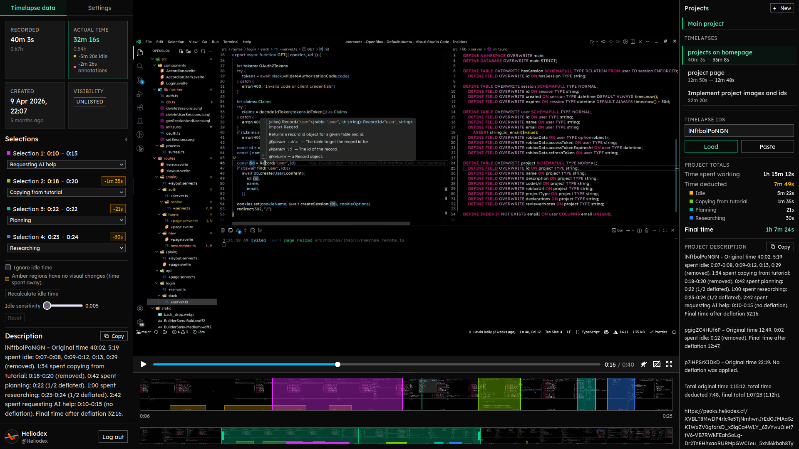

# Peaks



The ultimate timelapse review tool

[peaks.heliodex.cf](https://peaks.heliodex.cf)

Peaks needs no Lapse account. It reads public and unlisted timelapses by ID through the public Lapse API, and keeps projects and reviews in your browser's local storage.

The app follows the [`wt`](https://github.com/heliodex/better-deploy/tree/main/wt) app layout: a static SvelteKit frontend in `web/` and a small Go WASM component at the root. The component serves `/healthz` and `/lapse-proxy`, which streams Lapse video so the canvas can read frames for timeline previews and idle detection. Everything else runs in the browser.

```sh
# Frontend
cd web
bun install
bun test
bun run svelte:check
bun run build

# Go component and media proxy
go test ./...
go vet ./...

# Local app with the wt supervisor and Vite HMR
wt dev --dir .

# Static frontend plus the app served by the supervisor
wt dev --dir . --vite=false

# Build an upload bundle
wt build --dir .
```
